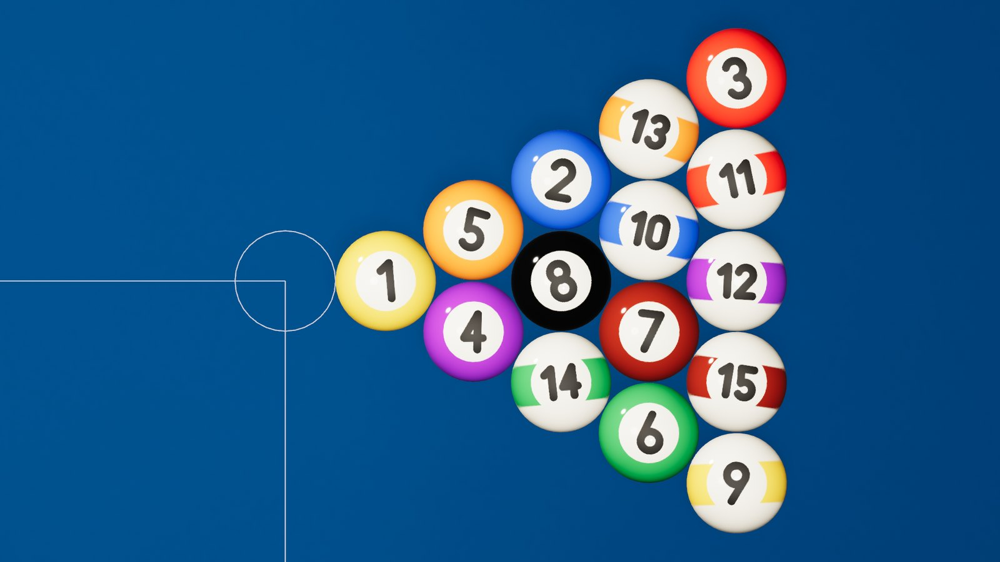

# CUE

**A billiards engine written in Rust, running in the browser through WebAssembly.**

**[▶ Live demo](https://otuletta.github.io/CUE/)**: the framework-free example host, deployed from every green build of `main`.



*Rendered by the engine itself, off-screen, with
`CUE_STILL=rack.png CUE_VIEW=rack cargo run -p cue-game --example still --release`.
No image, font or sound file ships with CUE.*

CUE has two parts that ship together:

- **A pool game** that runs inside a web page. There is no sign-up and no
  backend. It has a 3D table, purpose-built physics, a free-play mode and
  local two-player eight-ball.
- **A library** that other sites can embed with one call and a container
  element. Embedding it does not require knowing Rust or Bevy.

> **Status: `1.0.0-beta.2`, feature-complete and in testing.** Free play,
> local eight-ball with WPA or casual rules, numbered balls and a modelled
> cue, adaptive graphics, procedural sound, and an embeddable npm package
> tested in a Vite app and under a strict CSP. Device testing is what
> remains before 1.0. This README describes only what exists; see the
> [roadmap](#roadmap).

## Use it

```sh
npm install @tuletta/cue   # provisional name; see docs/releasing.md
```

```js
const { createCue } = await import('@tuletta/cue');
const game = await createCue({ container: document.querySelector('#cue') });
game.on('game-over', ({ winner }) => console.log(`rack to ${winner}`));
```

- **[Web integration](docs/web-integration.md):** plain HTML, Vite, React,
  Vue and single-page apps; hosting, CDN and CSP.
- **[API reference](docs/api.md):** options, methods, events, state and codes,
  with [TypeScript declarations](web/package/src/index.d.ts).
- **[Browser support](docs/browser-support.md):** what is tested, and how.

## What works today

- **Event-driven physics.** Sliding, rolling and spin decay are closed-form.
  Collisions are found analytically, so nothing tunnels. A shot is
  **bit-for-bit identical at any frame rate**, which the test suite asserts on a
  full break played at 7, 30, 60 and 144 FPS. See the
  [physics model](docs/physics-model.md).
- **Verified textbook behaviour:** 5/7 rolling speed after a stun shot, natural
  roll at a tip height of 2R/5, the 90° rule, follow and draw, and the rolling
  stopping distance.
- **Real table behaviour:**
  - Cushions respond at nose height (after Han, 2005), so side spin changes
    rebound angles and rails take topspin off.
  - Balls throw each other and transfer spin.
  - Side spin squirts the cue ball.
  - Pockets follow the WPA facing angles and shelf depths: a ball frozen to
    the rail drops in the corner, a shot at the point bounces out, and side
    pockets reject shallow angles. See [ADR-0007](docs/adr/0007-cushion-and-pocket-model.md).
- **Shot reports:** every shot produces an immutable `ShotReport` for the
  rules. It records first contact, pocketed balls, scratches, rail contacts
  (marking frozen balls, WPA 2.7) and the cue ball's head-string crossings
  (WPA 3.11).
- **Eight-ball rules engine:** a pure state machine over shot reports, with
  no engine and no physics. It covers WPA 8-Ball (*Rules of Play*, effective
  2025-09-15): the break and its options, the open table, called shots and
  safeties, standard fouls with ball in hand, losing the rack, spotting,
  stalemates and alternating breaks. A test per rule (38 cases) checks it
  without a GPU. [rules-eight-ball.md](docs/rules-eight-ball.md) goes through
  the WPA text rule by rule: implemented, not applicable to digital play, or
  adapted, with each of CUE's adjudications. See
  [ADR-0010](docs/adr/0010-eight-ball-rules-and-call-shot.md).
- **Two-player eight-ball:** match setup (names that are never stored, rules,
  race length, who breaks) and a scoreboard. The call is proposed from the
  aim, drawn on the table and editable in an accessible dialog. Decisions
  and rack results appear in panels that keep the table visible, and every
  ruling is announced in one sentence.
- **Browser build:** ≈ 4.2 MiB Brotli for the engine plus ≈ 28 KiB for the control layer, eight-ball included (6.8 MiB gzip as GitHub Pages serves it), 120 FPS on the reference desktop,
  first frame under a second after clicking Play. Pausing stops the engine
  completely (0 frames). See the [measurements](docs/benchmarks/phase-1-web.md).
- **Accessible controls:** an HTML layer in a shadow root over the canvas
  (toolbar, power slider, Shoot button, 2D spin selector, dialogs, live
  announcements) and a complete keyboard path. See [controls](docs/controls.md)
  and [accessibility](docs/accessibility.md).
- **Free play:** cue ball in hand at the break and after scratches, one-level
  undo (an exact snapshot, even mid-shot), and automatic re-racking.
- **Procedural audio:** ball clicks, cushion thumps, pocket drops and cue
  strikes are synthesised in Rust with modal synthesis, as are three quiet
  cues for a turn, a foul and a won rack. No audio files ship. See
  [ADR-0009](docs/adr/0009-procedural-audio.md).
- **Visual direction with no asset files:**
  - **Balls:** numbers from a stroke font drawn for CUE, in mip-mapped
    textures. A fresh rack shows the numbers facing up.
  - **Cue:** eight sections, from the chalked tip to the bumper. It swings
    in before the strike lands, or not at all with reduced motion.
  - **Table:** diamond sights, a marked foot spot, a faint cloth grain, and
    contact shadows fitted to the table.

  Everything is listed in [docs/assets.md](docs/assets.md); see
  [ADR-0011](docs/adr/0011-visual-direction-and-graphics-quality.md).
- **A camera that respects the controls:** the playing surface stays clear
  of the top bar and the dock. The camera moves off-axis, so aiming is
  unaffected.
- **Graphics quality:** Auto, High, Medium and Low change only
  anti-aliasing, shadows and, at Low, the resolution. Auto steps down by
  itself if the frame rate stays low. Dense screens render at most two
  pixels per CSS pixel (`render.pixelRatioCap`).
- **Themes and preferences:** classic, studio and high-contrast themes, plus
  three aiming-guide levels. Settings are validated and kept in `localStorage`
  under `cue:v1:*`.
- **Embedding API:** `createCue({ container })` returns an instance with:
  - lifecycle: `start`, `pause`, `resume`, `attach` (move to another
    container, for single-page apps), `resize`, `destroy`;
  - table: `rerack`, `undo`, `shoot`, `setPower`, `setTip`;
  - eight-ball: `setMode`, `newGame({ ruleset, breaker, raceTo, names })`, `freePlay`,
    `callBall`, `callSafety`, `autoCall`, `decide`, `nextRack`, `stalemate`,
    `spotRequest`;
  - preferences: `setTheme`, `setAssists`, `setQuality`, `setAudio`;
  - layout: `setViewInsets` for hosts with their own controls;
  - state and display: `getState` (including the match: players, groups,
    score, shooter, stage, call, decision), `enterFullscreen`, `on(event)`.

  Events: `ready`, `shot-start`, `ball-pocketed`, `shot-end` (with a shot
  summary), `racked`, `undo`, `paused`, `resumed`, `settings-change`,
  `fullscreen-change`, `destroyed`, `error`. In a match the referee also
  reports `new-game`, `ruling`, `foul`, `groups-assigned`, `turn-changed`,
  `decision-required`, `decided`, `game-over`, `match-over`, `ball-spotted`,
  `shot-refused` and `call-refused`. Every name in these events (fouls,
  options, pockets) is a stable code, ready for the host to translate.
  Loading shows real progress from a build manifest. The vanilla example
  uses no framework.

## Why it is built this way

| Choice | Reason |
|--------|--------|
| Rust everywhere that matters | Simulation, rules and game logic are the real implementation, not a wrapper. |
| Purpose-built physics, not a generic engine | Sliding-to-rolling, cloth resistance, spin and cushion rebound have closed-form models; a generic solver only approximates them. See [ADR-0002](docs/adr/0002-custom-billiards-solver.md). |
| Engine-free core | Rules and physics compile and test natively in milliseconds, with no GPU or browser. |
| No backend | Static files only. CUE collects no personal data. |

## Architecture

```text
host page ──▶ cue-web ──▶ cue-game ──▶ cue-physics ──▶ cue-core
              (wasm-bindgen) (Bevy)     (solver)        (domain)
```

| Crate | Responsibility | Depends on Bevy? |
|-------|----------------|:----------------:|
| [`cue-core`](crates/cue-core) | Ball, pocket and rail identity, WPA table spec, racks, deterministic RNG, `ShotReport`, eight-ball rules | no |
| [`cue-physics`](crates/cue-physics) | Event-driven solver: motion regimes, cushion and pocket geometry, contact models, strikes, versioned profiles | no |
| [`cue-game`](crates/cue-game) | Bevy app: scene, procedural ball textures, aiming, camera, HUD, free play and eight-ball sessions | yes |
| [`cue-audio`](crates/cue-audio) | Procedural modal synthesis of the impact sounds | no |
| [`cue-web`](crates/cue-web) | WASM boundary: lifecycle, commands, state snapshot, events, Web Audio playback | yes |
| [`web/package`](web/package) | `createCue()` ES module wrapper and the accessible control layer | — |

Units are SI. The origin is the centre of the playing surface, `+X` points
towards the foot rail and `+Y` points up.

## Development

You need [rustup](https://rustup.rs). The exact toolchain and the WASM target
are pinned in [`rust-toolchain.toml`](rust-toolchain.toml) and install
automatically on first use.

```bash
cargo test --workspace                              # all tests
cargo test -p cue-physics --release -- --ignored    # 1,000-shot stress test
cargo run -p cue-game --example sandbox             # play natively
CUE_STILL=table.png cargo run -p cue-game --example still --release   # render a still, no window
cargo fmt --all -- --check                          # formatting
cargo clippy --workspace --all-targets -- -D warnings
```

### Browser build

You also need the `wasm-bindgen` CLI at the exact version in `Cargo.lock`
(the build script checks it), and Node.js for the size report.

```bash
cargo install wasm-bindgen-cli --version 0.2.129 --locked
scripts/build-web.sh                                # → web/dist
python3 scripts/serve.py                            # http://127.0.0.1:8765
```

**Controls:** move the pointer to aim, then press, drag back and release to
shoot. A release with almost no pull cancels. You can also use the power
slider and the Shoot button. The full mouse, touch and keyboard reference is
in [docs/controls.md](docs/controls.md).

## Roadmap

| Phase | Goal | Exit criterion |
|-------|------|----------------|
| 0 ✓ | Skeleton, CI, first ADRs | `cargo check` and `cargo test` pass on a clean install |
| 1 ✓ | Vertical slice in the browser | A simple table with a controllable shot in WASM, plus real size and FPS measurements |
| 2 ✓ | Billiards engine | Critical physics cases pass; the solver produces a `ShotReport` |
| 3 | Free Play (built; [usability test](docs/usability-test.md) pending) | A first-time visitor can shoot, understand the result, reset and leave |
| 4 | Local eight-ball (built; review pending) | Every rule transition in scope is covered by tests |
| 5 | Visuals, audio, polish (built, device check pending) | Approved on the device matrix with no physics regressions |
| **6** | Open-source 1.0 (`1.0.0-beta.2`; release after testing) | An outside developer can embed CUE using only the public docs |

The full product and engineering specification (in Spanish) is in
[`docs/specification.es.md`](docs/specification.es.md).

## Documentation

| | |
|---|---|
| [Getting started](docs/getting-started.md) | Tools, build, and every check CI runs |
| [Architecture](docs/architecture.md) | The crates and one shot from input to ruling |
| [Physics model](docs/physics-model.md) | Equations, parameters, limits |
| [Eight-ball rules](docs/rules-eight-ball.md) | WPA conformance, rule by rule |
| [Web integration](docs/web-integration.md) · [API](docs/api.md) | Embedding CUE |
| [Controls](docs/controls.md) · [Accessibility](docs/accessibility.md) | Playing CUE |
| [Browser support](docs/browser-support.md) · [Assets](docs/assets.md) | What is tested; what ships |
| [Releasing](docs/releasing.md) · [Changelog](CHANGELOG.md) | Versions and releases |
| [Contributing](CONTRIBUTING.md) · [Security](SECURITY.md) | Working on CUE |
| [Decisions](docs/adr) | 13 ADRs with their trade-offs, and where each open question of the spec was answered |

## License

The code is dual-licensed under [MIT](LICENSE-MIT) or
[Apache-2.0](LICENSE-APACHE), at your option. CUE ships no third-party assets:
every texture, mesh and sound is generated in code, under the same licence
([docs/assets.md](docs/assets.md)).
